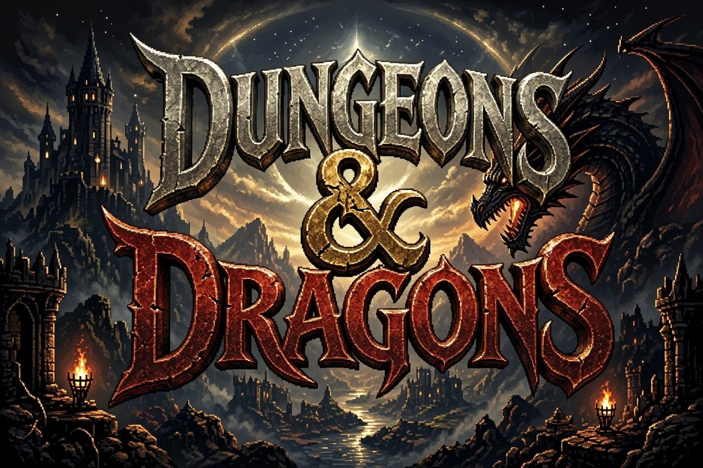

<div align="center">

# 🐉 Gerador de Fichas de D&D 5e

**Crie um personagem completo em segundos, role os dados e imprima a ficha pronta para a mesa.**

-7a1f1f?style=for-the-badge&logo=python&logoColor=f6efe3&labelColor=3b0f0f)


  

</div>

---

## ✨ Recursos

| | |
|---|---|
| 🧝 **Personagem completo** | 9 raças, 12 classes, 12 antecedentes e níveis de 1 a 20 |
| 🎲 **Atributos** | 4d6 (descarta o menor), 3d6 clássico ou array padrão, com distribuição otimizada para a classe ou aleatória |
| 🛡️ **Tudo calculado** | Modificadores, proficiência, salvaguardas, perícias, PV, CA, iniciativa e ataques |
| 🔮 **Conjuração** | CD, ataque mágico, espaços de magia e truques |
| 🎯 **Rolador de dados** | Expressões como `2d6+3`, vantagem/desvantagem e testes direto da ficha |
| ⚖️ **Descontos** | Regra caseira: desvantagens sorteadas dão pontos para comprar vantagens |
| 🖨️ **Exportação** | Imprimir, salvar em HTML ou TXT, ou copiar o texto |

---

## 🚀 Instalação e uso

**Requisitos:** Python 3.8+ (desenvolvido com Python 3.13) com Tkinter (já incluso no Windows e macOS; no Linux: `sudo apt install python3-tk`). Não há outras dependências.

```bash
python gerador_ficha.py
```

### Passo a passo

1. **Criação**: preencha nome, raça, classe, antecedente e nível.
2. **Descontos** *(opcional)*: sorteie desvantagens e escolha vantagens.
3. Clique em **🎲 Gerar Personagem**.
4. **Ficha**: confira o resultado e imprima, salve ou copie.
5. **Dados**: role livremente ou teste perícias e ataques com os valores da ficha.

### As quatro abas

| Aba | Para que serve |
|---|---|
| 🛠️ Criação | Dados do personagem e opções de geração |
| ⚖️ Descontos | Sorteio de desvantagens e compra de vantagens |
| 📜 Ficha | Ficha pronta, com impressão e exportação |
| 🎲 Dados | Rolador e testes da ficha |

---

## ⚖️ Sistema de descontos

Uma regra caseira opcional para dar mais personalidade ao herói:

1. 🎲 O programa sorteia **2 ou 3 desvantagens**, que dão pontos.
2. 🛒 Com esses pontos, você escolhe **até 3 vantagens**.
3. 🚫 O gasto não pode passar dos pontos ganhos.

> **Exemplo:** o sorteio traz *Fobia* (+1) e *Procurado pela lei* (+2). Com 3 pontos, você pode comprar *Treino defensivo* (+1 de CA).

Os efeitos entram na ficha automaticamente. Para mudar os limites, edite `DESV_MIN`, `DESV_MAX` e `MAX_VANTAGENS` no código.

---

## ⚠️ Limitações

- A ficha mostra as características de classe do **nível 1**; para os níveis seguintes, consulte o Livro do Jogador.
- **Subclasses, talentos e magias específicas** não são escolhidos pelo programa.
- O equipamento é o **kit inicial padrão** da classe.

---

<div align="center">

<sub>Dungeons & Dragons é marca registrada da Wizards of the Coast. Projeto não oficial feito por fãs.</sub>

</div>
