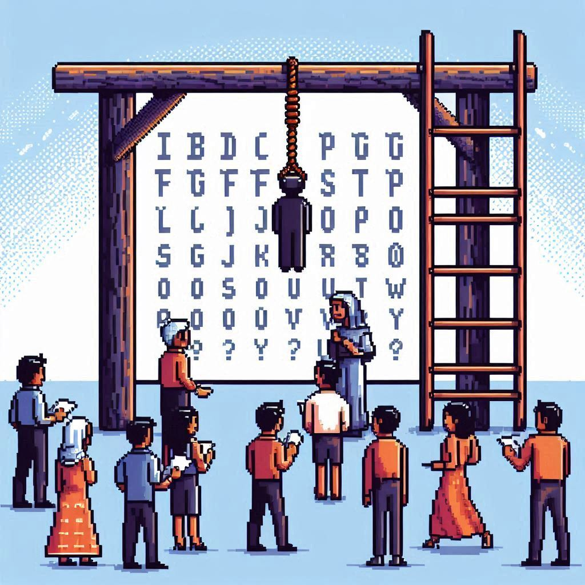
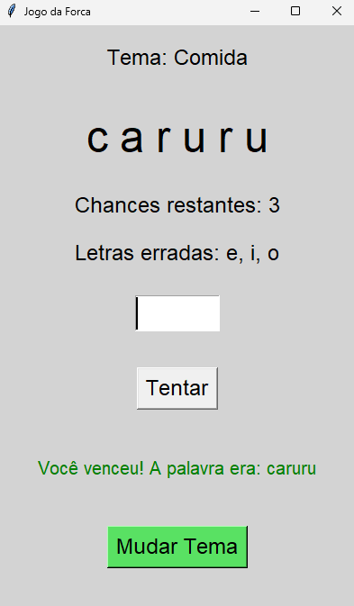

# 🎯 JOGO DA FORCA
<p align="center">
   
</p>

### Teste seus conhecimentos e descubra a palavra secreta!

Prepare-se para um desafio de adivinhação! Neste jogo da forca, você deverá descobrir uma palavra oculta tentando acertar suas letras antes que suas chances acabem.

## 🎮 COMO JOGAR?

1. Inicie o jogo e receba um tema aleatório.
2. Descubra o tamanho da palavra observando os espaços disponíveis.
3. Digite uma letra por tentativa.
4. Acompanhe as letras descobertas e as tentativas incorretas.
5. Acerte todas as letras antes de perder suas 6 chances!

## 🎲 TEMAS DISPONÍVEIS

O jogo seleciona aleatoriamente uma das seguintes categorias:

- 🎬 **Filmes:** títulos de filmes conhecidos.
- 🍕 **Comidas:** diferentes pratos e alimentos.
- 🌎 **Países:** países de diferentes partes do mundo.

## ⚙️ FUNCIONALIDADES

- Seleção aleatória de temas e palavras.
- Interface gráfica interativa.
- Exibição das letras descobertas.
- Contagem de tentativas restantes.
- Registro das letras incorretas.
- Identificação automática de vitória ou derrota.
- Opção de mudar o tema e iniciar uma nova rodada.

## 🛠️ TECNOLOGIAS

- **Python:** linguagem de programação.
- **Tkinter:** desenvolvimento da interface gráfica.
- **Random:** geração aleatória de temas e palavras.

## 🚀 COMO EXECUTAR?

1. Certifique-se de ter o Python instalado.
2. Baixe ou clone este repositório.
3. Acesse a pasta do jogo.
4. Execute o arquivo Python:

```bash
python main.py
```
<p align="center">
   
</p>

## 🏆 SEU DESAFIO COMEÇA AGORA!

Será que você consegue descobrir a palavra antes que suas chances acabem?

**Boa sorte e divirta-se!** 🐍
