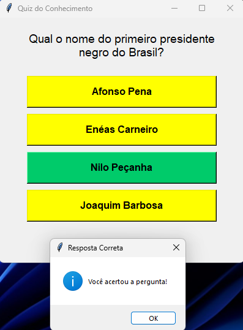

<p align="center">
   
</p>

# 🧠 QUIZ DO CONHECIMENTO

### Teste seus conhecimentos e desafie sua memória!

Prepare-se para responder perguntas sobre história, música, cultura brasileira, geografia, entretenimento, esportes e muito mais!

O Quiz do Conhecimento é um jogo de perguntas e respostas no qual cada rodada apresenta 10 questões selecionadas aleatoriamente. Será que você consegue acertar todas?

---

## 🎮 COMO JOGAR?

1. Inicie o jogo para receber as perguntas.
2. Leia atentamente cada questão.
3. Escolha uma das quatro alternativas disponíveis.
4. Confira se sua resposta está correta.
5. Ao final das 10 perguntas, veja sua pontuação!

## 📚 CATEGORIAS DE CONHECIMENTO

O jogo reúne perguntas sobre diferentes assuntos:

- 🌎 Geografia e conhecimentos gerais.
- 📜 História do Brasil.
- 🎵 Música e cultura popular.
- ⚽ Esportes.
- 🎬 Cinema e televisão.
- 📖 Literatura e personalidades brasileiras.
- 💡 Ciência e tecnologia.

## ⚙️ FUNCIONALIDADES

- Seleção aleatória de 10 perguntas.
- Quatro alternativas para cada questão.
- Identificação visual de respostas certas e erradas.
- Destaque da alternativa correta.
- Contagem de acertos.
- Exibição da pontuação final.

## 🛠️ TECNOLOGIAS UTILIZADAS

- **Python:** linguagem de programação.
- **Tkinter:** desenvolvimento da interface gráfica.
- **Pandas:** organização e gerenciamento das perguntas.
- **Random:** embaralhamento e seleção aleatória das questões.

## 🚀 COMO EXECUTAR?

Primeiro, instale as dependências necessárias:

```bash
pip install pandas
```

Em seguida, execute o arquivo:

```bash
python main.py
```

É necessário ter o Python instalado no computador.

---
<p align="center">
   
</p>

## 🏆 DESAFIO FINAL

São 10 perguntas, quatro alternativas e apenas uma resposta correta por questão.

**Quantos pontos você consegue fazer?**

Boa sorte e divirta-se! 🐍
