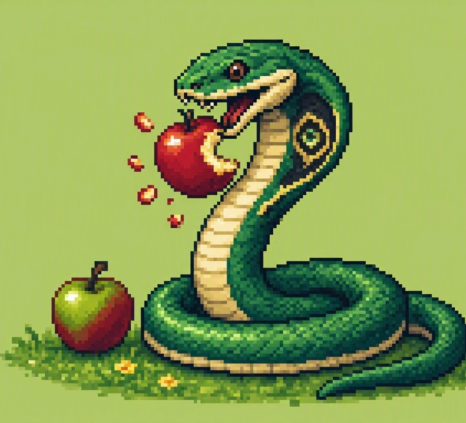
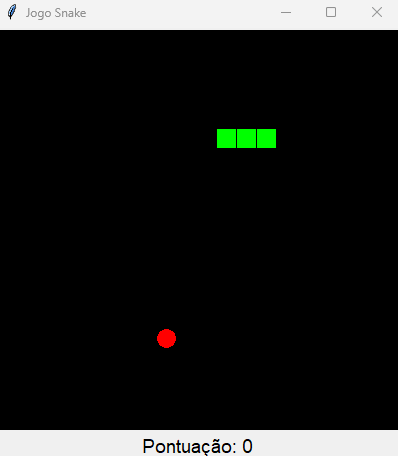

# 🐍 JOGO DA COBRINHA
<p align="center">
   
</p>

### Alimente a cobra, aumente sua pontuação e evite colidir!

Um clássico dos jogos de arcade! Controle uma cobra que percorre o cenário em busca de comida. A cada alimento coletado, sua pontuação aumenta e a cobra cresce, tornando o desafio cada vez maior.

## 🎮 COMO JOGAR?

1. Inicie o jogo.
2. Utilize as setas do teclado para controlar a cobra.
3. Colete os alimentos vermelhos espalhados pelo cenário.
4. Cada alimento coletado aumenta sua pontuação.
5. Evite bater nas paredes ou no próprio corpo da cobra.

## 🕹️ CONTROLES

| Tecla | Ação |
|---|---|
| ⬆️ Seta para cima | Mover para cima |
| ⬇️ Seta para baixo | Mover para baixo |
| ⬅️ Seta para esquerda | Mover para esquerda |
| ➡️ Seta para direita | Mover para direita |

## ⚙️ FUNCIONALIDADES

- Movimentação controlada pelo teclado.
- Geração aleatória de alimentos.
- Crescimento da cobra ao coletar comida.
- Sistema de pontuação.
- Detecção de colisões.
- Tela de Game Over com pontuação final.

## 🛠️ TECNOLOGIAS UTILIZADAS

- **Python:** linguagem de programação.
- **Tkinter:** criação da interface gráfica e do cenário.
- **Random:** geração aleatória da posição dos alimentos.

## 🚀 COMO EXECUTAR?

Certifique-se de ter o Python instalado e execute o arquivo:

```bash
python main.py
```

Não é necessário instalar bibliotecas externas, pois o jogo utiliza recursos nativos do Python.

---
<p align="center">
   
</p>


## 🏆 QUAL SERÁ SUA MAIOR PONTUAÇÃO?

Teste seus reflexos, mantenha a cobra em movimento e tente superar seu próprio recorde!

**Boa diversão! 🐍**
