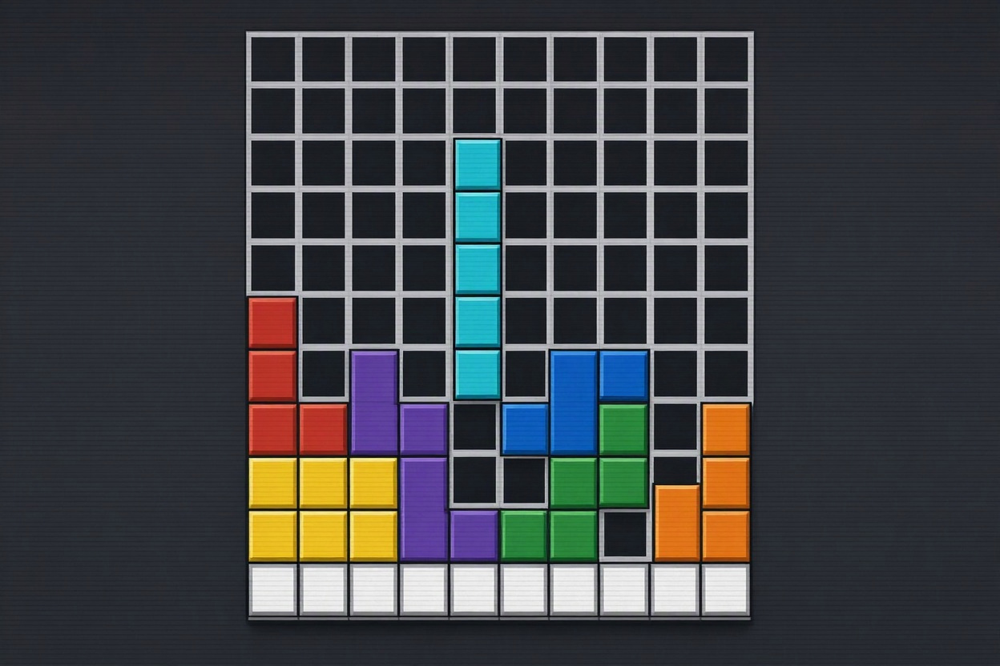
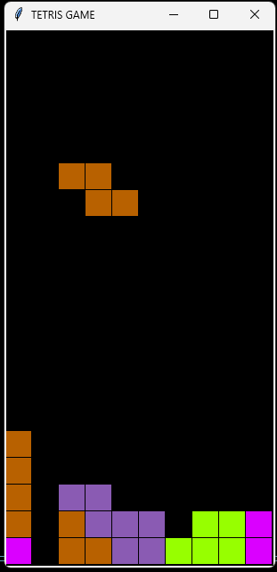

# 🧩 TETRIS GAME
<p align="center">
   
</p>

### Organize as peças, complete linhas e alcance a maior pontuação!

Um clássico dos jogos de raciocínio e estratégia! No Tetris, seu objetivo é organizar peças de diferentes formatos que caem do topo da tela, encaixando-as para completar linhas horizontais e liberar espaço no tabuleiro.

Prepare-se para testar sua coordenação, agilidade e capacidade de planejamento!

---

## 🎮 COMO JOGAR?

1. Inicie o jogo e aguarde as peças aparecerem.
2. Utilize as setas do teclado para movimentá-las.
3. Encaixe as peças para completar linhas horizontais.
4. Cada linha completa é eliminada do tabuleiro.
5. Evite que as peças alcancem o topo da tela!

## 🕹️ CONTROLES

| Tecla | Ação |
|---|---|
| ⬅️ Seta esquerda | Mover para esquerda |
| ➡️ Seta direita | Mover para direita |
| ⬇️ Seta para baixo | Acelerar a descida |
| ⬆️ Seta para cima | Rotacionar a peça |

## 🧱 PEÇAS DISPONÍVEIS

O jogo utiliza diferentes formatos de peças, inspirados nos tradicionais blocos do Tetris.

## ⚙️ FUNCIONALIDADES

- Geração aleatória de peças e cores.
- Movimentação pelo teclado.
- Rotação das peças.
- Detecção de colisões.
- Eliminação automática de linhas completas.
- Sistema de pontuação.
- Identificação de fim de jogo (Game Over).

## 🛠️ TECNOLOGIAS UTILIZADAS

- **Python:** linguagem de programação.
- **Tkinter:** criação da interface gráfica e do tabuleiro.
- **Random:** geração aleatória das peças e cores.

## 🚀 COMO EXECUTAR?

Certifique-se de ter o Python instalado e execute o arquivo:

```bash
python main.py
```

Não é necessário instalar bibliotecas externas.

---
<p align="center">
   
</p>

## 🏆 DESAFIO FINAL

Quantas linhas você consegue completar antes que o tabuleiro fique cheio?

Organize suas peças, planeje seus movimentos e tente alcançar a maior pontuação!

**Boa sorte e bom jogo! 🧩**
